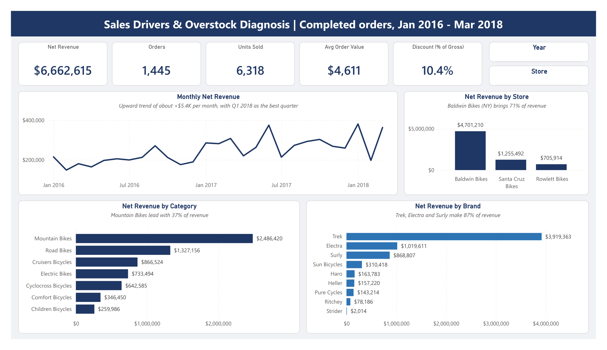

# Sales Drivers and Overstock Diagnosis for a Multi-Store Bike Retailer

End-to-end analysis, from raw data to business recommendations, answering one question for a three-store bicycle retailer: *where does revenue come from, and does the stock in each store match what actually sells?*

**Data period:** January 2016 – March 2018 (27 months) | **Analysis base:** 1,445 completed orders, net revenue $6.66M<br>
**Prepared by:** Arif Herfian Zaen Chartiko (Data Analyst)<br>
**Prepared for:** Management of a multi-store bike retailer (three stores in California, New York and Texas)



---

## Start Here

| If you need                           | Open                                                                                                                         |
| ------------------------------------- | ---------------------------------------------------------------------------------------------------------------------------- |
| A meeting summary (13 slides)         | [`deliverables/presentation_sales_drivers_overstock_diagnosis.pptx`](deliverables/presentation_sales_drivers_overstock_diagnosis.pptx)             |
| The full report and reasoning         | [`deliverables/report_sales_drivers_overstock_diagnosis.pdf`](deliverables/report_sales_drivers_overstock_diagnosis.pdf) (also `.docx` / [`.md`](deliverables/report_sales_drivers_overstock_diagnosis.md)) |
| To explore the data yourself          | [`deliverables/dashboard/`](deliverables/dashboard/), Power BI dashboard (`.pbix`) with a PDF version and screenshots        |
| A quick Excel report                  | [`process/02_excel/sales_drivers_overstock_report.xlsx`](process/02_excel/sales_drivers_overstock_report.xlsx)                             |
| The business questions and data used  | [`data_and_questions/business_questions.md`](data_and_questions/business_questions.md)                                       |
| To review or re-run the analysis      | [`process/README.md`](process/README.md)                                                                                     |

## Folder Structure

```
Sales Drivers and Overstock Diagnosis Multi-Store Bike Retailer/
├── data_and_questions/   Inputs: business questions + 9 raw CSV files
├── process/              The work, in order:
│   ├── 01_sql/           database, exploration, cleaning, analysis Q1–Q7
│   ├── 02_excel/         quick management report with charts
│   └── 03_python/        advanced analysis
├── deliverables/         Final outputs: report, presentation, dashboard
└── README.md
```

---

## Key Findings

1. **Growth came from selling more expensive bikes.** Revenue rose 41% in 2017 while orders rose only 8%. A price-volume-mix bridge shows that 55% of the growth came from the shift to Road and Electric bikes, and only 5% from higher prices.
2. **One store carries the business.** Baldwin Bikes (New York) brings 70.6% of revenue but holds only 32% of the stock. Rowlett Bikes (Texas) holds 181 months of stock at its current sales rate.
3. **Stock is far too high.** Stock is worth $19.8M at list price, three times the revenue of all 27 months. 2018 models hold 73% of it, and 35 stocked products ($2.2M) did not sell at all in the last 12 months.
4. **Revenue is concentrated.** 52 products (19% of those sold) make 80% of revenue (Gini 0.76). Trek, Electra and Surly make 87%.
5. **The biggest discount does not pay off.** Lines with a 20% discount sell no more units than lines with 5% (permutation test, p = 0.32), yet the 20% level is 48% of all discount cost.

## Recommendations

| # | Action | Expected effect |
| - | ------ | --------------- |
| 1 | Move stock from Rowlett and Santa Cruz to Baldwin (about 5,300 units) and pause their new deliveries | Stock follows demand |
| 2 | Clear the 35 products with no sale in 12 months ($2.2M at list price) | Frees cash and space |
| 3 | Buy new models in line with the sales rate, reviewed monthly by category | No repeat of the 2018 build-up |
| 4 | Keep the 52 class A products always in stock in every store | Protects 80% of revenue |
| 5 | Test removing the 20% discount level for one quarter | About $165K a year in discount cost |
| 6 | Keep growing Road and Electric bikes, with stock in line with sales | Keeps the growth engine without adding overstock |
| 7 | Start recording product cost and repeat-customer data | Enables margin and retention analysis |

Limitations (no cost data, one completed order per customer, an undated stock snapshot) are described in the [report](deliverables/report_sales_drivers_overstock_diagnosis.pdf).

---

## Tools Used

| Tool | Used for |
| ---- | -------- |
| PostgreSQL | Database, 37 exploration queries, cleaning views, business questions Q1–Q7 |
| Excel | Quick management report with charts (live formulas) |
| Python (pandas, numpy, matplotlib) | Advanced analysis: revenue bridge, ABC/Pareto, stock cover, permutation test, basket analysis |
| Power BI | Interactive dashboard (4 pages, 16 DAX measures) |
| Word and PowerPoint | Report and presentation |

## Data Source

[Bike Store Sample Database](https://www.kaggle.com/datasets/dillonmyrick/bike-store-sample-database) (Kaggle).
