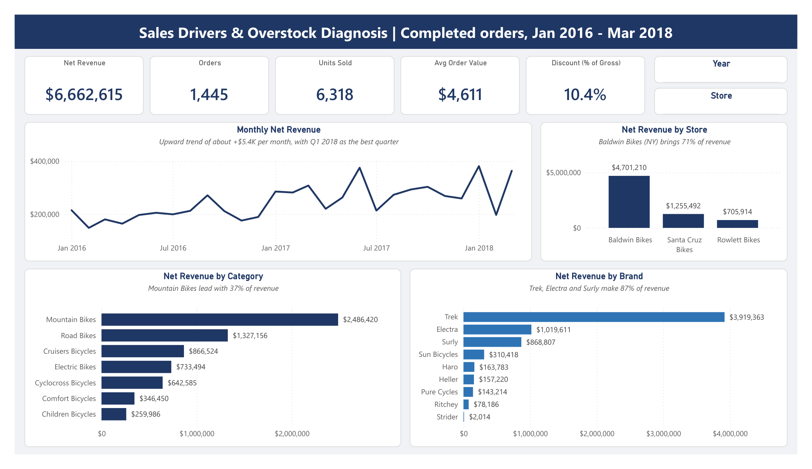
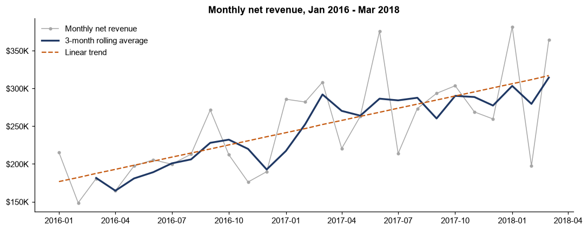
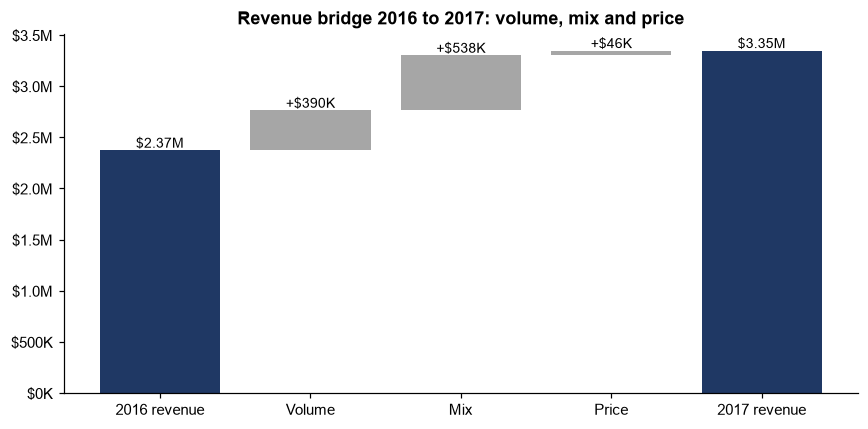
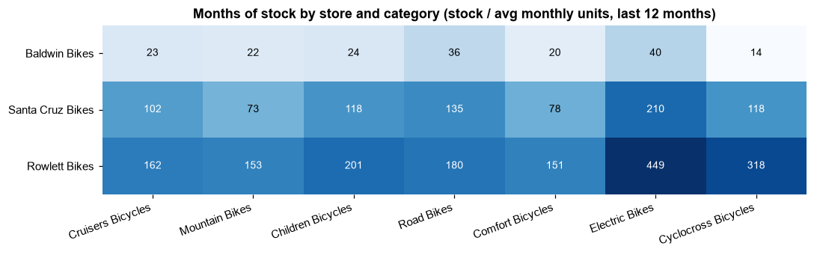
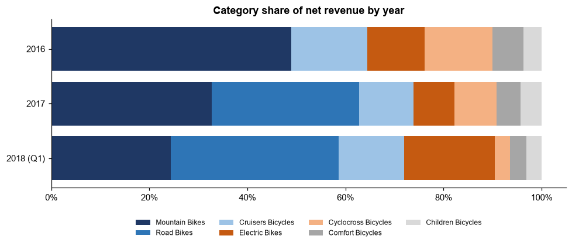
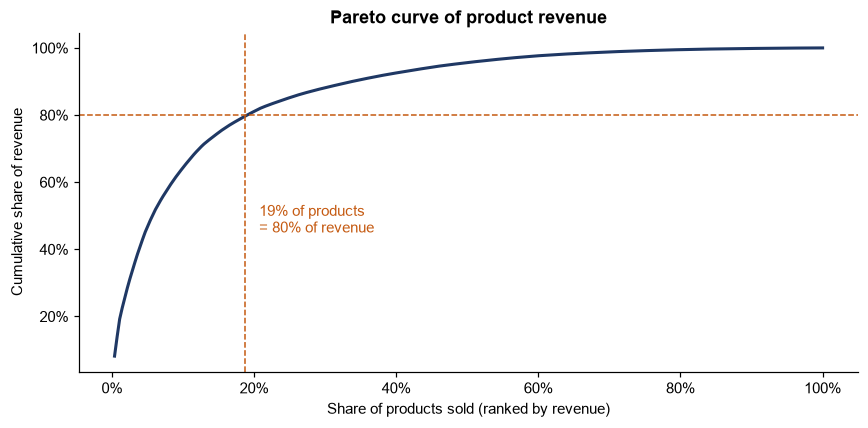
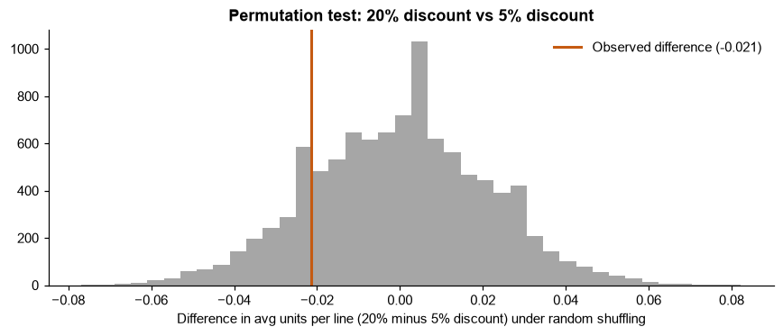

# Sales Drivers and Overstock Diagnosis for a Multi-Store Bike Retailer

**Data period:** January 2016 – March 2018 (27 months) | **Analysis base:** 1,445 completed orders, net revenue $6,662,615 
**Prepared by:** Arif Herfian Zaen Chartiko (Data Analyst) 
**Prepared for:** Management of a multi-store bike retailer (three stores in California, New York and Texas)

---

## 1. Executive Summary

Revenue grew strongly, but the stock behind it is in the wrong place and far larger than sales need.

- **Growth came from selling more expensive bikes.** Revenue rose 41% in 2017 while orders rose only 8%. More than half of the growth (55%) came from the shift to Road and Electric bikes, not from more customers or higher prices.
- **One store carries the business.** Baldwin Bikes (New York) brings 70.6% of revenue but holds only 32% of the stock. Rowlett Bikes (Texas) holds 181 months of stock at its current sales rate.
- **Stock is far too high.** Stock is worth $19.8M at list price, three times the revenue of all 27 months. 2018 models hold 73% of it, and 35 stocked products ($2.2M) did not sell at all in the last 12 months.
- **Revenue is concentrated.** 52 products (19% of those sold) make 80% of revenue. Trek alone makes 59%.
- **The biggest discount does not pay off.** Lines with a 20% discount sell no more units than lines with 5% (1.50 vs 1.52 units, p = 0.32), yet the 20% level is 48% of all discount cost ($372K over 27 months).

**Top recommendations:** move about 5,300 units of stock from Rowlett and Santa Cruz to Baldwin, run a clearance plan for the 35 non-moving products, keep the 52 best-selling products always in stock, and test removing the 20% discount level.

---

## 2. Background and Questions

The retailer runs three stores and sells 9 brands across 7 categories. Management asked for a sales and inventory review: where revenue comes from, how the stores and products perform, and whether the stock held in each store matches what actually sells.

| #  | Question                                                         |
| -- | ---------------------------------------------------------------- |
| Q1 | How has revenue developed over time?                             |
| Q2 | How does each store perform, and does its stock match its sales? |
| Q3 | How do sales staff compare within each store?                    |
| Q4 | Which categories and brands drive revenue?                       |
| Q5 | How concentrated is revenue across products?                     |
| Q6 | Where is stock too high compared with sales?                     |
| Q7 | How much do discounts cost, and do bigger discounts sell more?   |

---

## 3. Data and Method

**Source:** Kaggle Bike Store Sample Database, 9 tables (orders, order items, products, brands, categories, stores, staff, customers, stock), loaded in full into PostgreSQL.

**Data quality checks (37 queries):** no impossible dates, negative values, untrimmed text or orphan records were found. Two findings shaped the analysis:

- Completed orders stop on 31 March 2018. April 2018 holds only pending and processing orders, and later months hold only rejected orders. The analysis therefore uses **completed orders from January 2016 to March 2018**.
- 29 product names appear under two categories with the same price. They are kept as separate products, as in the source.

**Definitions**

- **Net revenue** = quantity × list price × (1 − discount).
- **Last 12 months** = April 2017 to March 2018, the most recent full year.
- **Months of stock** = units in stock ÷ average monthly units sold in the last 12 months.

**Tools:** PostgreSQL (cleaning views and Q1–Q7), Excel (management report), Python with pandas, numpy and matplotlib (revenue bridge, Pareto, permutation test), Power BI (dashboard). All totals were checked to match across the four tools.

---

## 4. Findings

### 4.1 Revenue grew through higher-priced bikes (Q1)

| Year            | Net revenue | Orders | Avg order value | Avg price per unit |
| --------------- | ----------: | -----: | --------------: | -----------------: |
| 2016            | $2,372,849  | 620    | $3,827          | $912               |
| 2017            | $3,346,973  | 671    | $4,988          | $1,105             |
| 2018 (Jan–Mar)  | $942,793    | 154    | $6,122          | $1,374             |

Revenue rose 41% in 2017 while orders rose only 8%. Q1 2018 ($942,793) was 8% above Q1 2017 and is the best quarter in the data. The trend adds about $5,400 per month, but single months swing widely, so the 3-month average is the better guide.

A price-volume-mix bridge splits the $974K growth from 2016 to 2017:

| Driver                                   | Effect     | Share of growth |
| ---------------------------------------- | ---------: | --------------: |
| Mix (more Road and Electric bikes)       | +$537,701  | 55%             |
| Volume (more units)                      | +$390,307  | 40%             |
| Price (higher price in the same category)| +$46,115   | 5%              |

Road Bikes had no sales in 2016 and brought $1.0M in 2017. Road and Electric together rose from 12% of revenue in 2016 to 53% in Q1 2018.

### 4.2 Baldwin Bikes carries the business, but stock is split equally (Q2)

| Store                  | Net revenue | % of revenue | % of stock | Months of stock |
| ---------------------- | ----------: | -----------: | ---------: | --------------: |
| Baldwin Bikes (NY)     | $4,701,210  | 70.6%        | 32.3%      | 25              |
| Santa Cruz Bikes (CA)  | $1,255,492  | 18.8%        | 33.5%      | 103             |
| Rowlett Bikes (TX)     | $705,914    | 10.6%        | 34.2%      | 181             |

Each customer buys only from the store in their own state, so the stores do not compete with each other. Baldwin and Rowlett grew about 50% in 2017, while Santa Cruz stayed flat ($544,659 to $544,197). The same overstock pattern appears in every category, so the issue is how stock is split between stores, not one product line.

### 4.3 Staff results follow store size (Q3)

Each store has two selling staff who split sales close to 50/50 (46.8% to 53.2%). No individual stands out on revenue. One operational signal: Mireya Copeland (Santa Cruz) has the highest late-shipment rate, 43.8% against 23.9% to 32.1% for the others.

### 4.4 Mountain Bikes and Trek lead (Q4)

| Category           | % of revenue | Avg price per unit |
| ------------------ | -----------: | -----------------: |
| Mountain Bikes     | 37.3%        | $1,547             |
| Road Bikes         | 19.9%        | $2,956             |
| Cruisers Bicycles  | 13.0%        | $465               |
| Electric Bikes     | 11.0%        | $2,911             |
| Cyclocross Bicycles| 9.6%         | $1,761             |
| Comfort Bicycles   | 5.2%         | $473               |
| Children Bicycles  | 3.9%         | $248               |

Cruisers and Children bikes are 46% of units sold but only 17% of revenue. Trek (58.8%), Electra (15.3%) and Surly (13.0%) make 87% of revenue.

### 4.5 A small set of products makes most of the revenue (Q5)

| Class | Products | % of products sold | % of revenue |
| ----- | -------: | -----------------: | -----------: |
| A     | 52       | 18.7%              | 79.6%        |
| B     | 80       | 28.8%              | 15.3%        |
| C     | 146      | 52.5%              | 5.0%         |

The Gini coefficient of product revenue is 0.76, which confirms strong concentration. Only 2 to 3 of the 52 class A products are out of stock in each store, so best-sellers are mostly available.

### 4.6 Stock is far above any sales rate (Q6)

| Model year | Stock value  | % of stock value | Months of stock |
| ---------- | -----------: | ---------------: | --------------: |
| 2016       | $987,113     | 5.0%             | 22              |
| 2017       | $4,428,514   | 22.3%            | 24              |
| 2018       | $14,403,955  | 72.7%            | 229             |

Every category holds almost 4 years of stock or more, from 46 months (Comfort) to 102 months (Electric). Part of the 2018 build-up is normal, because these models were still new when the data ends. Even so, 35 stocked products worth $2,215,816 did not sell once in the last 12 months.

If the current 13,511 units were split in line with each store's sales, 5,328 units would move to Baldwin (2,113 from Santa Cruz and 3,215 from Rowlett). Each store would then hold the same 55 months of stock. This helps Baldwin, but total stock would still be high.

### 4.7 The 20% discount does not lift sales (Q7)

| Discount | Order lines | Avg units per line | Discount cost | % of discount cost |
| -------: | ----------: | -----------------: | ------------: | -----------------: |
| 5%       | 1,078       | 1.52               | $98,164       | 12.7%              |
| 7%       | 1,026       | 1.49               | $130,987      | 16.9%              |
| 10%      | 1,026       | 1.48               | $174,453      | 22.5%              |
| 20%      | 1,084       | 1.50               | $371,791      | 47.9%              |

Discounts cost $775,395 in total, a steady 10.4% of gross revenue each year. A permutation test (10,000 shuffles) found no difference in units per line between the 20% and 5% levels (p = 0.32).

**Other observation:** 76% of orders contain more than one category, and order value rises with the number of categories (median $1,023 for one category, $5,121 for three). No category pair is bought together more often than chance, so there is no specific cross-sell pair to promote.

---

## 5. Recommendations

| # | Action | Based on | Expected effect |
| - | ------ | -------- | --------------- |
| 1 | Move stock from Rowlett and Santa Cruz to Baldwin (about 5,300 units in the full scenario) and pause new deliveries to Rowlett and Santa Cruz until their months of stock fall. | 4.2, 4.6 | Stock follows demand, and fewer lost sales at Baldwin. |
| 2 | Run a clearance plan for the 35 products with no sale in 12 months ($2.2M at list price), starting with the oldest model years. | 4.6 | Frees cash and space. |
| 3 | Buy 2018 and later models in line with the sales rate, reviewed monthly by category, with Electric and Road first. | 4.6 | Prevents a repeat of the 2018 build-up. |
| 4 | Treat the 52 class A products as "never out of stock" items with a minimum stock level in every store. | 4.5 | Protects 80% of revenue. |
| 5 | Test removing or targeting the 20% discount level for one quarter and track units per line. | 4.7 | The 20% level cost $372K over 27 months (about $165K a year), with no volume lift seen so far. |
| 6 | Keep growing Road and Electric bikes, the main growth driver, while keeping their stock in line with sales. | 4.1, 4.4 | Keeps the growth engine without adding overstock. |
| 7 | Start recording product cost and repeat-customer data. | 6 | Enables margin and retention analysis next time. |

---

## 6. Limitations

- **No cost data:** profit and margin cannot be calculated, so recommendations focus on revenue, stock and discount cost.
- **One completed order per customer:** retention and repeat purchases cannot be analysed.
- **Stock is a single undated snapshot:** stock movement over time cannot be tracked, and stock is compared with the last 12 months of sales.
- **Sample data:** discount levels, shipping times and order weekdays are spread almost evenly, which suggests generated data. Patterns in these fields should be read with care.
- **Data ends in March 2018:** 2018 models had only three months of sales.

---

## 7. Appendix

| Item | Location |
| ---- | -------- |
| Business questions and data | `data_and_questions/business_questions.md` |
| SQL exploration (37 queries), cleaning views and Q1–Q7 | `process/01_sql/` |
| Excel management report | `process/02_excel/sales_drivers_overstock_report.xlsx` |
| Python advanced analysis | `process/03_python/analysis.ipynb` |
| Power BI dashboard (`.pbix` and PDF) | `deliverables/dashboard/` |
